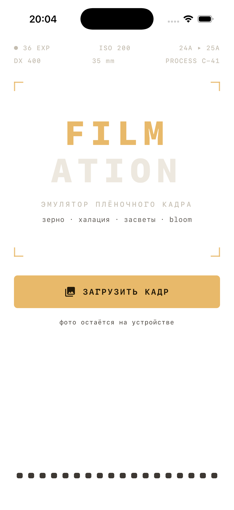

# Filmation

[]() []() []()

Эмуляция плёночного кадра — Kotlin Multiplatform (Android + iOS), Compose Multiplatform.

Загружаешь фото → крутишь слайдеры (зерно, халация, bloom, засветы, виньетка и др.) или выбираешь пресет известной плёнки → сохраняешь результат в галерею.



> Статус: ранняя версия — рабочий прототип, эффекты и пресеты продолжают настраиваться.
> Всё фото обрабатывается **на устройстве**, ничего никуда не отправляется.

---

## Стек

| Компонент | Технология | Версия |
|---|---|---|
| Язык | Kotlin (K2) | 2.2.20 |
| UI | Compose Multiplatform (Material 3) | 1.12.2 |
| Сборка | Gradle + version catalog | 9.8.2 |
| Android | AGP, minSdk 29, target/compile 36 | 9.5.0 |
| iOS | Xcode-проект + Kotlin framework (static), deployment target 16.0 | Xcode 26.x |
| Графика (iOS decode/encode) | Skia через skiko | 0.150.2 (транзитивно от CMP) |
| Графика (движок) | **Чистый Kotlin CPU-рендерер** | — |

> ⚠️ **Важно про версии**:
> 1. Kotlin должен совпадать с ABI-линией klib'ов Compose Multiplatform. Для CMP 1.12.2:
>    нативные (iOS) klib'ы собраны Kotlin **2.3.20** (`compiler_version` в манифесте klib),
>    поэтому рабочий компилятор — **2.3.21**. Слишком старый (2.2.20) не читает их:
>    `KLIB resolver: Could not find ...klib`; слишком новый (2.4.21) не видит skiko 2.2.20:
>    `Cannot access class 'org.jetbrains.skia.Image'`. При апгрейде CMP смотреть манифест
>    `~/.gradle/caches/.../<artifact>-iosSimulatorArm64Main-<ver>.klib → default/manifest`.
> 2. AGP 9 несовместим со старым KMP-стилем `androidTarget()` в application-модуле — обходим флагами
>    `android.newDsl=false` + `android.builtInKotlin=false` (см. gradle.properties). Правильное решение
>    при апгрейде — разделить проект на `:shared` (KMP library) + тонкий `:androidApp` (application).
> 3. При применении плагинов в модуле KMP: сначала `kotlin-multiplatform`, потом `com.android.application`
>    (иначе конфликт расширений `kotlin` из-за builtInKotlin в AGP 9).

### Compose Preview / Gradle Sync в IntelliJ IDEA и Android Studio

CMP-плагин регистрирует задачи `generate<Debug|Release>ComposePreviewRunfiles`, и без двух настроек
configuration-фаза падает при каждом sync с `Could not create task ... PreviewRunfiles`:

1. **unit-тесты у варианта** (KMP выключает их у release). В AGP 9 старые свойства
   `enableUnitTest`/`unitTestEnabled` скрыты (`@Deprecated(level = HIDDEN)` → «Unresolved reference»),
   включать нужно новым API:
   ```kotlin
   androidComponents {
       beforeVariants(selector().withBuildType("release")) { variant ->
           (variant as? com.android.build.api.variant.HasHostTestsBuilder)
               ?.hostTests?.get(com.android.build.api.variant.HostTestBuilder.UNIT_TEST_TYPE)
               ?.enable = true
       }
   }
   ```
2. **ресурсы в unit-тестах**: `testOptions { unitTests { isIncludeAndroidResources = true } }`.

После этого `generate{Debug,Release}ComposePreviewRunfiles` создаются; при ручном запуске из CLI
задача законно просит `--compose-preview-manifest-file` — его передаёт IDE, это не ошибка.

## Ключевое архитектурное решение: почему CPU, а не шейдеры

Изначально движок задумывался как **один SkSL-шейдер Skia RuntimeEffect в общем коде**
(skiko есть на обеих платформах → GPU-превью без OpenGL/Metal). Проверка сборкой показала:

- **iOS**: skiko доступен в общем коде, RuntimeEffect работает ✅
- **Android**: Compose Multiplatform на Android — это AndroidX Compose; **классов org.jetbrains.skia.*
  на android-таргете нет вообще** (общие метаданные компилируются, реальный таргет — нет).
  AGSL RuntimeShader есть, но только с API 33+ и это уже второй шейдер.

Итог: **движок эффектов переписан в чистый Kotlin (CPU)** — `FilmRenderer`. Один код,
одинаковый результат на обеих платформах, легко отлаживать и тестировать.
Производительность: превью ~1024px — десятки мс (release), экспорт 4096px — 1–2 с.
Платформенный код остался только там, где без него нельзя: пикер, галерея, decode/encode.

**GPU-путь (если понадобится v2)**: AGSL RuntimeShader на Android 33+ + skiko RuntimeEffect на iOS,
шейдеры почти совместимы синтаксически. Или MediaPipe/LibYUV-обёртки. См. бэклог.

## Структура проекта

```
filmation/
├── composeApp/                  — весь Kotlin-код приложения
│   ├── commonMain/              — UI + движок эффектов (общий для Android и iOS)
│   │   ├── com/filmation/
│   │   │   ├── App.kt           — корень, тема, навигация экранов (состоянием)
│   │   │   ├── fx/              — ДВИЖОК ЭФФЕКТОВ
│   │   │   │   ├── FilmParams.kt    — модель параметров (все слайдеры)
│   │   │   │   ├── FilmRenderer.kt  — CPU-конвейер эффектов (чистый Kotlin)
│   │   │   │   ├── PixelImage.kt    — общий формат пикселей + box-blur/downscale
│   │   │   │   ├── PhotoSources.kt  — три копии фото: export/preview/glow
│   │   │   │   └── FilmPresets.kt   — пресеты «плёнок»
│   │   │   ├── photo/               — expect/actual: пикер, сохранение, decode/encode
│   │   │   └── ui/                  — HomeScreen, EditorScreen
│   ├── androidMain/             — MainActivity, пикер (Photo Picker API),
│   │                              галерея (MediaStore), decode (BitmapFactory+EXIF)
│   └── iosMain/                 — MainViewController, пикер (PHPicker),
│                                  галерея (PHPhotoLibrary), decode/encode (skiko)
└── iosApp/                      — Xcode-проект (AppDelegate + shell-фаза на Gradle)
```

## Как работает движок эффектов

`FilmRenderer.render()` — один проход по пикселям выходного изображения, эффекты по порядку:

1. **Хроматическая аберрация** — радиальный сдвиг R/B-каналов к краям кадра (билинейная выборка)
2. **Экспозиция** — умножение на `2^EV`
3. **Bloom** — свечение ярких участков (аддитивно, из размытой копии)
4. **Халация** — красно-оранжевое свечение вокруг яркого (screen blend), как у киноплёнки
5. **Артефакты** (слайдер «Засветы и блики») — процедурные утечки света: два тёплых пятна
   по краям кадра + блики-«призраки» вдоль оси «самое яркое пятно → центр» (пятно ищется
   в glow-копии один раз на рендер). Позиции детерминированы `seed` → превью и экспорт совпадают
6. **Плёночная S-кривая** — контраст `c·c·(3−2c)` со смесью по силе
7. **Fade** — матовые, слегка обесцвеченные тени (поднятый чёрный)
8. **Ч/б** (для пресетов типа Tri-X)
9. **Сплит-тонирование** — света (тепло/холод) и тени (бирюза/пурпур) независимо
10. **Виньетка** — радиальное затемнение
11. **Зерно** — целочисленный детерминированный шум, блочный, максимум в полутонах,
    размер привязан к изображению (одинаково в превью и экспорте), `seed` — «переброс»

### Pinch-to-zoom превью

- Жест: `detectTransformGestures` + `graphicsLayer` (масштаб 1..8, пан с ограничением,
  двойной тап — сброс). Трансформация применяется мгновенно к уже готовому битмапу.
- Через ~200мс после окончания жеста превью **перерендеривается из более детального источника**:
  при зуме > 1 используется не preview-копия (1024px), а полный оригинал (до 4096px),
  разрешение выхода = 1080 × zoom (потолок 3200). Т.е. зум показывает настоящие детали фото.

### Источники для рендера

`PhotoSources` готовит три копии загруженного фото (все — `PixelImage`, плотный IntArray ARGB):
- `export` — до 4096px (финальный рендер при сохранении);
- `preview` — до 1024px (интерактивное превью);
- `glow` — до 260px, box-размытая низкочастотная копия — источник bloom/халации.
  Размытие под конкретный радиус выполняется один раз на рендер (`boxBlurred` — сепарабельный
  box ×2 прохода на крошечном изображении, копейки), в основном цикле — одна билинейная выборка.

### Поток данных

```
Пикер (платформенный) → байты фото
  → decodeToPixelImage (expect): Android = BitmapFactory + EXIF-поворот + scale;
                                  iOS = skiko Image.makeFromEncoded + scale + readPixels
  → PhotoSources (export 4096 / preview 1024 / glow 260)
  → FilmRenderer.render(preview) → PixelImage → toImageBitmap → показ     [превью, в фоне]
  → FilmRenderer.render(export) → encodeJpeg (Bitmap/skiko) → галерея    [экспорт]
```

Превью рендерится «насосом» в `LaunchedEffect` на `Dispatchers.Default`. Оптимизации отзывчивости:

- **Рендер-насос (~60 Гц опрос изменений)**: рендер стартует сразу после завершения предыдущего,
  устаревшие тяжёлые рендеры прерываются по `isCancelled` (проверка раз в 8 строк + при смене
  параметров) — драг слайдеров и пинч никогда не ждут «залипший» кадр.
- **Во время драга слайдера** превью рендерится в пониженном разрешении (560px, `DRAG_PREVIEW_SIDE`),
  по отпусканию — в полном (до 1080px). Старый кадр остаётся на экране, пока готовится новый.
- **Дебаунс зума**: перерендер под зум (из полного оригинала, до 3200px) — только после того,
  как жест «успокоился» 250мс (`TimeSource.Monotonic`).
- **Box-blur на скользящем окне** — O(1) на пиксель, радиус не влияет на время.
- iOS: skiko-объекты (`Image`/`Bitmap`/`Surface`) закрываются явно (try/finally) — нет утечек
  нативной памяти; сохранение в галерею защищено таймаутом от зависания.

### Параметры (FilmParams)

В UI оставлены только 9 «импактных» слайдеров (экспозиция, bloom, халация, контраст, fade,
тепло света, зерно, виньетка, засветы/блики). Остальные поля модели управляются пресетами и рандомом,
но работают в рендерере:

| Поле | Диапазон | Что делает |
|---|---|---|
| `exposure` | −2…+2 EV | экспозиция |
| `curve` | 0…1 | плёночная S-кривая контраста |
| `fade` | 0..1 | матовые тени |
| `mono` | bool | ч/б |
| `grain` / `grainSize` | 0…1 / 0.5…3 | зерно |
| `halation` / `halationRadius` | 0…1 | халация |
| `bloom` / `bloomRadius` | 0…1 | свечение |
| `vignette` | 0…1 | виньетка |
| `warm` | −1…+1 | света: тепло/холод |
| `tint` | −1…+1 | тени: бирюза/пурпур |
| `ca` | 0…1 | хроматическая аберрация |
| `artifacts` | 0…1 | засветы/утечки света и блики |
| `seed` | int | переброс зерна и позиций артефактов |

Кнопка-кубик в AppBar — **случайная плёнка** (все параметры в осмысленных пределах + новый seed зерна).

### Пресеты

Portra (мягкая портретная), Gold (тёплая), CineStill (сильная халация),
Tri-X (ч/б, крупное зерно), Fuji (холодная), Cross (кросс-процесс), Expired (просроченная).
Пресет — просто готовый `FilmParams`, дальше крутится руками.

## Как добавить новый эффект

1. Добавить `Float`-поле в `FilmParams`.
2. Добавить шаг в конвейер `FilmRenderer.render()` (в нужном порядке, до упаковки пикселя).
3. Добавить слайдер в `EditorScreen` (`ParamSlider`).
4. (Опционально) использовать в пресетах.

## Платформенные детали

- **Android**: Photo Picker (без пермишенов), MediaStore `Pictures/Filmation` (без пермишенов с API 29 — потому minSdk 29), EXIF-поворот через `ExifInterface`.
- **iOS**: `PHPickerViewController` (без пермишенов на выбор; UIImage→PNG для нормализации ориентации и HEIC), сохранение через `PHPhotoLibrary.performChanges` — нужен `NSPhotoLibraryAddUsageDescription` (есть в `iosApp/iosApp/Info.plist`).
- **iOS decode/encode**: только тут используется skiko (он доступен на iOS-таргете): `Image.makeFromEncoded` понимает JPEG/PNG/WebP.
- **iOS Info.plist**: обязательно `CADisableMinimumFrameDurationOnPhone = true` — без этого ключа
  Compose Multiplatform **падает на старте** с `IllegalStateException` (PlistSanityCheck проверяет
  поддержку 120 Гц ProMotion). Симптом: приложение закрывается через ~2-20 секунд после запуска
  без видимой причины; текст исключения виден только в консоли (`simctl launch --console-pty`).

### Грабли Kotlin/Native ↔ ObjC interop (проверено на Kotlin 2.3.21)

- Параметр метода протокола — ONE имя (ObjC label), не два: `fun picker(picker: PHPickerViewController, didFinishPicking: List<*>)` — без второго имени `results`.
- Методы ObjC-классов попадают в companion: `PHPhotoLibrary.sharedPhotoLibrary()`, `PHAssetChangeRequest.creationRequestForAssetFromImage(image)` (ObjC-имя, не Swift-ренейм `creationRequestForAsset(from:)`).
- Категорийные методы — extension'ы и требуют импорта: `import platform.Foundation.appendBytes`.
- `UIGraphicsImageRenderer.PNGDataWithActions { }` — с ЗАГЛАВНОЙ PNG (ObjC-имя селектора).
- `NSData(bytes: CPointer)` строится через `NSMutableData + appendBytes(usePinned/addressOf)`; чтение — `data.bytes as CPointer<ByteVar>` → `.readBytes(length)` (extension на CPointer).
- Сцены: `scene.windows` — это `List<UIView>`, для `rootViewController` нужен `filterIsInstance<UIWindow>()`.

## Сборка и запуск

### Общее
```bash
./gradlew tasks          # список задач
```

### Android
```bash
./gradlew :composeApp:assembleDebug      # debug APK → composeApp/build/outputs/apk/debug
```
Или открыть проект в Android Studio, конфигурация `composeApp`.

### iOS
```bash
cd iosApp
# Рабочая CLI-команда (обходит резолюцию destination — платформа iOS 26.2 не скачана):
xcodebuild -project iosApp.xcodeproj -target iosApp -sdk iphonesimulator26.2 ARCHS=arm64 \
  -configuration Debug CODE_SIGNING_ALLOWED=NO \
  SYMROOT=build CONFIGURATION_BUILD_DIR=build/Debug-iphonesimulator build
```
Или открыть `iosApp/iosApp.xcodeproj` в Xcode, выбрать симулятор, Run.
Сборка дергает Gradle-задачу `:composeApp:embedAndSignAppleFrameworkForXcode` (shell-фаза в начале сборки);
фреймворк появляется в `composeApp/build/xcode-frameworks/Debug/iphonesimulator26.2/`.

> Примечание: для запуска из Xcode GUI может понадобиться докачать платформу
> (Xcode → Settings → Components → iOS 26.2) — сейчас установлен только рантайм симулятора 26.1.
> Дымовой тест пройден: приложение собирается, ставится и запускается на iPhone 17 Pro (iOS 26.1), без крашей.

## Лицензия

MIT — см. [LICENSE](LICENSE).

## Планы
- [ ] Прогнать на устройстве/симуляторе, тюнинг констант эффектов под реальные фото
- [ ] Рамка кадра с перфорацией, светоутечки, пыль/царапины (процедурные)
- [ ] Жест zoom/pan превью, сравнение «до/после» сплитом
- [ ] Кэш последнего фото, history/undo
- [ ] Разделить на :shared + :androidApp (снять флаги android.newDsl/builtInKotlin)
- [ ] (Опция) GPU-путь: AGSL на Android 33+, skiko RuntimeEffect на iOS — при нехватке скорости CPU

## Известные компромиссы

- Превью — CPU-рендер: во время драга слайдеров рендер идёт в 560px (мгновенный отклик),
  полный кадр — на отпускании; тяжёлые рендеры прерываются при смене параметров.
- Вход ограничен 4096px.
- Экспорт — JPEG q95.
- Названия пресетов — оммажи характеру плёнок, не колориметрическая копия.
- База локали — русский (`values/`), английский — `values-en/`; при смене целевой аудитории
  достаточно поменять файлы местами.
